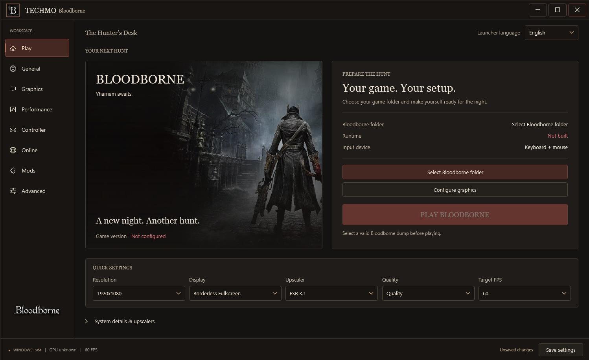
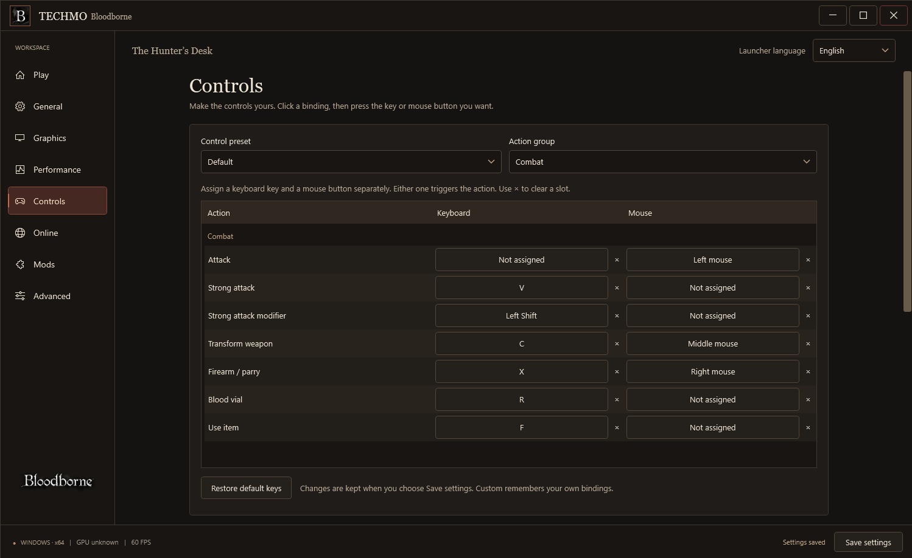
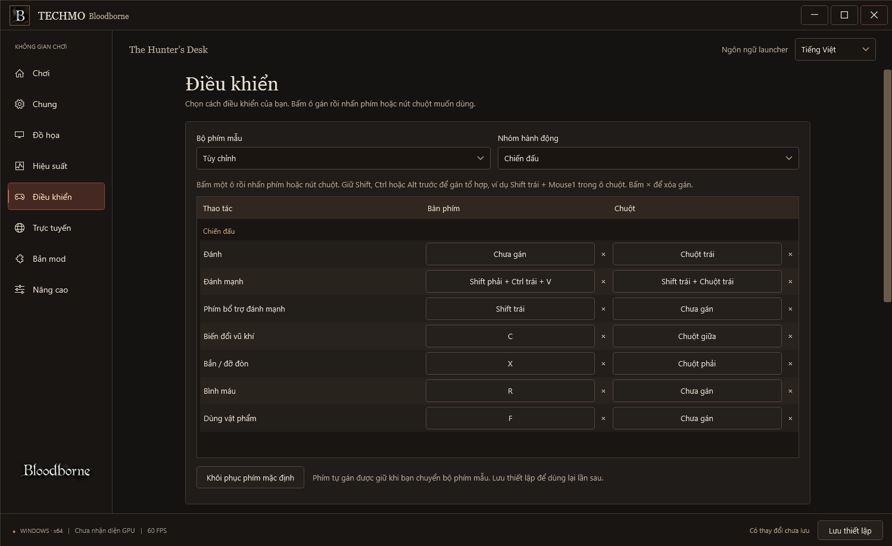

<div align="center">

# Techmo Bloodborne

**A Windows home for Bloodborne. Built to be understood, tuned and improved.**

Windows x64 · Vulkan · C# / WPF · English + Tiếng Việt

[Build](docs/guides/BUILD.md) · [Project map](docs/ARCHITECTURE.md) · [Contribute](CONTRIBUTING.md) · [Tiếng Việt](README.vi.md)

</div>

Techmo brings the launcher, native runtime and renderer into one Windows-focused
workspace. Pick your game folder, configure controls and graphics, and keep your
settings in one place. The interface starts in English and can switch to Vietnamese.

The **Hunter’s Desk** interface pairs game artwork with launch controls, quick
settings and expandable system details. The language selector stays available
on every page, and smaller windows use a scrolling layout.



## What you can configure

- Click-to-bind keyboard/mouse controls with Shift/Ctrl/Alt combinations, Default / Dark Souls 3 / Custom presets
  and controller selection.
- Render/output resolution, 30 / 60 / 90 FPS presets and available upscalers.
- Mods, community patches and optional shadNet connection settings.
- English or Vietnamese launcher UI, independent of the game's language.

In **Controls**, click a keyboard or mouse slot and press the desired input.
Esc cancels, **×** clears one slot, and **Save settings** keeps the changes.
Custom bindings are retained when switching presets. For `Left Shift + Mouse1`,
click the mouse slot, hold Left Shift and click the left mouse button. The same
capture supports multiple side-specific modifiers, keyboard keys and the wheel.
The new combination syntax requires an engine rebuilt from this source.

<details>
<summary>Preview the Controls page</summary>





</details>

Available graphics features depend on the GPU, driver and installed assets.
Restructuring the project or changing the launcher does not by itself raise FPS.

## Start with the source

You need Windows 10/11 x64, a Vulkan 1.3 capable GPU and your own **Bloodborne
CUSA03173 v1.09** dump. Game files are not included. The launcher needs a .NET SDK
to build; the native engine uses MSYS2 **CLANG64**.

From PowerShell in the repository root:

```powershell
./tools/build-launcher.ps1
```

Double-click `builds/TEST-LAUNCHER.cmd` to test the latest build. The executable
is written to `builds/launcher/Techmo.Launcher.exe`; caches and previous local
builds are grouped under `builds/_internal`.
Build the engine separately using the [Windows build guide](docs/guides/BUILD.md),
then open the launcher and select your game folder.

## A project with clear boundaries

```text
apps/launcher/       WPF interface, translations and launcher checks
engine/runtime/      Game loader and Windows runtime
engine/renderer/     Vulkan renderer, host shims and renderer dependencies
scripts/             Game preparation, patching and Windows launch pipeline
tools/               Build helpers, setup and development utilities
tests/               Preparation, runtime, input and renderer regressions
third_party/         Shared native dependencies
patches/             Community patch definitions
docs/                Build guide, architecture and development notes
licenses/            Upstream and third-party license notices
builds/              Local output only; excluded from Git
```

The renderer's vendored dependency layout stays intact so updates remain
reviewable. A normal source checkout includes the pinned dependencies; there
are no submodules to fetch. [DEPENDENCIES.md](DEPENDENCIES.md) records their origins.

## Current development state

The bilingual launcher has passed **485 behavior/UI and input compatibility
checks**, using synthetic fixtures and SDL key-name validation. The
Python suite passes **74 tests**; **28 native tests** are skipped until their
engine binaries are built. The reorganized launcher is compiled locally.
A full engine rebuild, an end-to-end game run, a full play-through and multiplayer
validation are still pending for this Techmo version.

The work ahead is practical: validate startup files, make saves atomic, test input
release behavior, and measure frame times before tuning the renderer.
See [development notes](docs/DEVELOPMENT.md).

## License and credits

Techmo's combined distribution uses **GPL-3.0-or-later**, consistent with the
inherited bbhost ports. Original source notices and dependency licenses remain
in place; GPL-2.0-or-later components retain their provenance.
Read [LICENSE](LICENSE), [LICENSING.md](LICENSING.md) and [NOTICE.md](NOTICE.md).

Bloodborne is a game by FromSoftware and Sony. Techmo is an independent project
and is not affiliated with or endorsed by either company.
