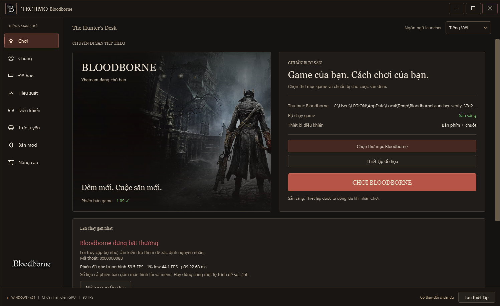

# Native baseline and session diagnostics

Build in the isolated Techmo checkout. The helper defaults to two build workers:

```powershell
./tools/build-native.ps1 -Bootstrap -Test
./tools/build-launcher.ps1
```

Bootstrap downloads signed CLANG64 packages into `builds/_internal/toolchain`
using the existing MSYS2 shell. It does not install them into the system MSYS2
prefix. Keep `packages.sha256` to identify the toolchain used for a local build.
Subsequent builds omit `-Bootstrap`. An existing system CLANG64 toolchain also
works. Native output and its required toolchain DLLs live under `out/`.

`out/native-build.json` records the compiler, selected SDK versions, source
fingerprint and binary hashes. Keep the exact native executables used by a
crashing session: they retain DWARF symbols. A minidump does not supply matching
symbols by itself. Do not strip those baseline binaries.

## Record a session

Open `builds/TEST-LAUNCHER.cmd`, select your own game dump and save settings.
In **Advanced**, enable **Record frame statistics (CSV)**. For deeper GPU work,
also enable **Record GPU timings**. These switches work without Developer Mode.
Leave Detailed logs off for ordinary comparisons: that option also changes an
inherited renderer barrier setting. Profilers themselves add measurement cost.

Every launch gets a separate `logs/<timestamp>-<id>/` directory:

| File | Contents |
| --- | --- |
| `session.log` | Preparation, native output and existing per-pass GPU statistics |
| `session.json` | Stage, exit status, selected settings, build provenance and measurements |
| `summary.txt` | Short result and references to supporting files |
| `frames.csv` | VideoOut flip intervals, Stage A thread CPU time, waits, uploads and compile counts |
| `gpu.csv` | GPU timestamp intervals when GPU profiling is enabled |
| `fault.json` | Native exception code, instruction address, thread and access operation |
| `crash.dmp` | Windows minidump for captured fatal native exceptions |
| `minidump.json` | Whether the external dump writer succeeded, with its Windows error code |

Optional files only exist when that recording path runs. A minidump is not
expected for preparation errors, ordinary exits, every Vulkan error, or an
external process kill. If the reporting process is killed, `session.json` can
remain marked `running`; the UI labels that report incomplete.

The Home page shows the last session result and an **Open session report** button.
The preview below uses synthetic UI test data; its FPS values are not Bloodborne
performance measurements.



It distinguishes preparation failures, known native exceptions and abnormal
exits whose cause is unknown. Device lost identifies a Vulkan failure; it does
not establish that VRAM exhaustion caused it. Reports and dumps stay local.
The structured settings snapshot omits account credentials; logs and minidumps
can still contain private paths or process memory. Inspect them before sharing.

## Compare the same route

Use the same source build, driver, power mode, game area, camera route and
graphics settings. Keep separate cold-cache and warmed-cache runs. Record at
least a few repeated routes; include combat and traversal. Stop at the game's
menu/close command so the buffered CSV tail is flushed on a normal exit.

Whole-session statistics include loading and menus. Extract a repeatable range:

```powershell
./builds/_internal/toolchain/clang64/bin/python.exe tools/analyze-session.py logs/SESSION --from-seconds 10 --to-seconds 70
```

This writes `benchmark.json` without replacing the original session report.
Average FPS is `1000 / mean(frame_ms)`. The 1% low is `1000 / mean` of the slowest
`ceil(N * 0.01)` intervals. p95/p99 use nearest-rank frame-time percentiles.
Zero/nonfinite/truncated rows are excluded; the skipped count is recorded.

Flip interval is frame pacing, not CPU execution time. `stage_a_cpu_ms` measures
one renderer thread's CPU consumption, not the whole CPU frame. GPU samples
cover recorded timestamp intervals with intervening copies/barriers/waits; they
are not paired one-to-one with flip CSV rows. Use Nsight for a complete CPU/GPU
timeline before attributing a bottleneck. A small CSV tail can be lost on crash
(up to 120 flip rows and 60 GPU rows are buffered between flushes).

GPU queries now collect without waiting on the CPU. If a four-frame query slice
is still in flight, it remains intact and profiling skips that frame. The slice
is reset only after its owning scheduler submission completes. `skipped_frames`
in `gpu.csv` is a cumulative counter at the time of the sample; the report keeps
the latest observed value. Heavy frames can be missed, so GPU averages from a
capture with skips should not be treated as an unbiased workload average.
See the Vulkan rules for [query results](https://docs.vulkan.org/refpages/latest/refpages/source/vkGetQueryPoolResults.html)
and [host query reset](https://docs.vulkan.org/refpages/latest/refpages/source/vkResetQueryPool.html).

New GPU captures also separate `labelled_work_ms` and
`between_submissions_ms`. Their sum is the recorded interval. The second field
tracks the scheduler's existing gap label, which can include frame pacing and
waiting for CPU work. Neither field is a hardware utilization counter; labelled
work still includes barriers and transfers. Older captures remain readable.
Session environment snapshots include Vulkan recording thread/segment settings,
async submission, direct segments and the FSR 4 shader variant setting.

## First renderer/runtime optimization pass

The Windows runtime caches QPC frequency through a thread-safe initializer. When
the frequency divides one billion exactly, integer multiplication converts ticks
to nanoseconds; other frequencies retain the quotient/remainder conversion.
The final sleep spin compares QPC ticks to a deadline rounded up once, preserving
the no-early-wake behavior. QPC frequency is fixed for the system boot, as covered
by [Microsoft's timing guidance](https://learn.microsoft.com/en-us/windows/win32/sysinfo/acquiring-high-resolution-time-stamps).

`tests/test_host_clock.c` checks concurrent clock reads, conversion against native
QPC and sleep deadlines. `gpu-profiler-test` uses real headless Vulkan queries,
deliberately withholds submissions, and checks that pending slices are preserved
and later reused. Build the latter with `ninja -C out/gpu gpu-profiler-test` in the
native shell, then run `out/gpu/gpu-profiler-test.exe` with an optional CSV path.
It requires a Vulkan-capable GPU and is not part of GPU-less hosted CI.
`tools/bench-runtime-clock.c` measures clock-call cost only. Clock throughput and
synthetic query tests do not establish a Bloodborne FPS gain.

Compare the rebuilt native runtime against a saved baseline on the same warmed
route, with the same 60 FPS patch, output, upscaler and effects. Also keep a run
with GPU recording off to assess profiler overhead. Record average FPS, 1% low,
p99 and visible artifacts/crashes. Do not change thread counts, barriers and
shader settings together; each needs a separate comparison.

The repository contains the host runtime/renderer source. A PS4 game dump holds
the game's executable and assets, not the game's C++ source. The loaded image
check in `scripts/game_check.py` currently targets CUSA03173 v1.09; patches and
runtime hooks depend on that executable layout. Texture/mesh mods can change
memory and upload costs even when the executable stays identical. Keep the
original game dump and list enabled mods when comparing performance.

## Validate without the game

`bb-probe.exe --vulkan-only` submits a tiny buffer fill and reads it back; it
does not load Bloodborne. Native regression fixtures cover the runtime and input.
The crash fixture raises a synthetic Windows exception and checks the original
exception stream inside the resulting remote minidump. WPF checks exercise
nonzero process exits and English/Vietnamese report presentation with synthetic
files. Passing these checks establishes a testable baseline; game stability and
performance on the GTX 1650 Ti / RTX 3050 / RTX 3050 Ti need real game runs on
those devices.

The dump writer runs outside the faulting process, following
[Microsoft's MiniDumpWriteDump guidance](https://learn.microsoft.com/en-us/windows/win32/api/minidumpapiset/nf-minidumpapiset-minidumpwritedump).
